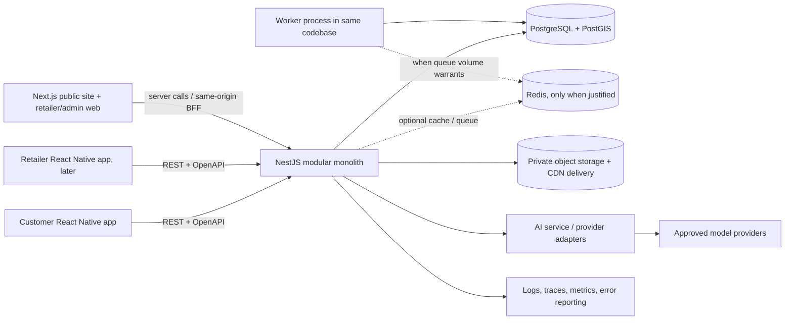

# DealSe technical architecture

**Status:** Target architecture and decision record, reconciled with the current local implementation. Proposed services and launch plans are not evidence that they are deployed.
**Last reviewed:** 2026-11-14
**Scope:** The first marketplace pilot and the path to grow it without prematurely splitting services.

> The prior D1/Cloudflare Worker proposal in `backend-foundation.md` and `prototype/migrations/0001_backend_foundation.sql` is superseded. Do not use it as the production backend plan. The Vite prototype remains the visual reference; the current local Next.js/NestJS implementation and verification evidence are tracked separately in [`mvp-readiness-audit.md`](mvp-readiness-audit.md). This document remains the target architecture, not proof of production deployment.

## How to read this document

- **Established** means visible in the repository or stated explicitly by the founder.
- **Recommendation** is the architecture proposed here.
- **Open decision** means product or operating policy is not established by the available materials; implementation must not invent it.

This blueprint is intentionally opinionated about engineering choices and explicit where product evidence is missing.

## Admin Backoffice implementation (2026-11-14)

The existing Supabase identity and NestJS API remain authoritative. Admin endpoints require the provider-verified AAL2 claim and database `admin` role, followed by an active `admin_accounts` record and the exact route permission. Root Admin receives permissions by role; other administrator roles remain least-privilege. The Backoffice implements retailer, store, offer, report, category, administrator and invitation workflows, private image review, audit history, and redemption-record inspection. The first Root Admin is established by the one-time server-side bootstrap documented in [ADR 0005](adr/0005-admin-backoffice-foundation.md). Existing admin role rows do not acquire permissions automatically. API integration coverage is present; authenticated Admin browser acceptance remains unverified pending a real AAL2 test account.

Local first-root setup and migration steps are documented in [Admin Backoffice local setup](admin-backoffice-local-setup.md). Invitation tables are persistence only until an authorized acceptance flow is implemented.

## A. Existing DealSe context (reconstruction)

| Topic | Established context | Gaps / confidence |
|---|---|---|
| A. Business/product vision | DealSe is a local marketplace intended to connect customers with nearby retailers and offers, beginning with Ahmedabad/Gujarat in the product materials. The retailer controls their store information and offer terms. | The available repo does not validate market size, demand, retention, conversion, or operating results. |
| B. Customer problem | The product hypothesis is that finding useful nearby local deals is fragmented and inconvenient; discovery should be local, visual, and easy to act on. | This is a product hypothesis, not validated user research. Priority segments and willingness to share location are unknown. |
| C. Retailer problem | The materials frame local retailers as needing a practical way to present products and offers to nearby customers, particularly in quiet trading periods, while retaining control of terms. | Retailer acquisition, willingness to publish offers, staff workflow, and measurable value are unvalidated. |
| D. Existing journeys | Customer: browse home/categories/nearby offers, open details, save/follow, see store/location, and claim a short-lived QR offer. Retailer: onboard, manage store/products/offers, review redemption history, validate a claim and confirm redemption. Admin: review and moderate retailers, stores, offers, reports and administrators. | Web/API paths are implemented and locally tested at the levels recorded in [`mvp-readiness-audit.md`](mvp-readiness-audit.md). Physical-camera scanning, POS integration, offline redemption and broad production operations are not verified or implemented. |
| E. Discussed features | Customer discovery, categories/search, favourites, store following, offer detail with a Redeem action, directions, notifications, retailer onboarding, store/product management, easy offer creation with suggestions, image choice/upload, retailer dashboard and redemption flow. AI-generated copy/creative and offer recommendations have been discussed. | Feature mentions are not equivalent to a committed MVP. AI and advanced inventory should not gate the first marketplace test. |
| F. Existing code/technology | `prototype/` contains the React 19/Vite visual reference and demo workspace. `apps/web` contains Next.js customer, retailer and Admin workspaces; `apps/api` contains the NestJS modular monolith; Prisma targets PostgreSQL/PostGIS. Supabase Auth is the web identity provider; roles and marketplace data remain in PostgreSQL. Separate Expo app shells exist. | The implementation is local/staging-candidate code, not a production deployment. Focused live-session customer/retailer browser coverage exists; Admin AAL2 browser acceptance and broader account journeys remain unverified. API route evidence is in [`api-routes.md`](api-routes.md) and [`mvp-readiness-audit.md`](mvp-readiness-audit.md). |
| G. Existing backend status | NestJS uses Prisma with PostgreSQL 18/PostGIS. Eight additive Prisma migrations are checked in; all eight were previously verified applied to local `dealse_dev`. Integration tests cover identity, marketplace, media, Admin moderation/management, notifications and QR redemption, including concurrent claim/confirmation capacity. | No production database migration or deployment is claimed. Production DB operations, Supabase configuration, private object storage, monitoring, backup/restore and rollback remain open. The D1/Worker artifacts are historical and must not be extended as production infrastructure. |
| H. Existing AI ideas | Offer-copy recommendations, AI-generated/selected offer imagery, and retailer-facing suggestions have been explored. The prototype has optional Gemini-oriented Worker endpoints. | No provider key/configuration or verified production AI path is present. The endpoint/provider implementation is experimental and should not define the future abstraction. |
| I. Monetization assumptions | Materials have referenced commercial ideas, but the repo's UX source labels pricing/fees and claims that require confirmation as unsettled. | No validated pricing, commission, subscription, promotion fee, payout or billing decision. Do not display fees or promise reach/results as fact. |
| J. Preserve | Product intent; selected local-discovery homepage and Ahmedabad visual context; supplied logo and approved imagery; customer pink and retailer teal audience distinction; customer deal-detail/redeem concept; retailer onboarding, offer creation, dashboard and history concepts; usable content and responsive behavior. | Preserve product decisions and visual assets selectively. Rebuild implementation where needed; do not preserve demo data as real records. |
| K. Rebuild/discard | Replace the single Vite app as the production platform, in-memory persistence, mock listings/metrics, and demo-only redemption state. Replace the D1/Worker backend direction with the selected API/database architecture. | The current prototype can remain a reference/preview until the new product slice is ready. Do not silently turn its sample data into seed production data. |
| L. Known technical debt | The web implementation contains prototype-derived client UI. `packages/contracts/openapi.yaml` is a legacy, incomplete contract and is not synchronized with all NestJS routes; there is no contract drift check. CI runs a Chromium public-marketplace browser job and a PostgreSQL/PostGIS API integration job. API throttling, retailer redemption analytics, Root Admin redemption reports, physical-device camera/WebView coverage, production object storage, observability and release/restore procedures remain open. | API tests and focused browser tests prove only the paths they exercise; they do not establish production readiness. Authenticated Admin browser acceptance and live MFA behavior remain unverified. |

### Approved P0 product defaults and remaining follow-ups

The user approved the P0 defaults in [`product-decisions-proposal.md`](product-decisions-proposal.md). The schema and first implementation should follow those defaults unless pilot research leads to an explicit revision:

1. Ahmedabad is the first live market; category taxonomy will be confirmed with pilot retailers before category seeding.
2. Public discovery is available signed out; sign-in is required for saving, following and redemption. Use Supabase Auth for identity. The current customer and retailer website flows use email + password. Mobile phone SMS OTP is planned for a later milestone.
3. Retailers create drafts; manual store verification is required before public discovery. Verified retailers publish their own offers; admin can pause a store or offer. Active retailer memberships cover the retailer's stores; no store assignment layer in P0.
4. Store-local validity uses an IANA time zone and UTC instants. Offers require terms and start/end. Inventory counts and variants are deferred. Pausing an offer blocks new codes and redemption confirmation while paused.
5. Online QR redemption is P0, requires sign-in, expires after five minutes, and is confirmed by an authenticated active retailer member. No offline success. Default one redemption per customer/deal; a deal may set a higher cap.
6. English first, minimal profile data, no date of birth or customer location history by default; free pilot with no billing or promises about reach/results.

Privacy notice, retention schedule, support/complaint process, age policy, SMS provider and country-specific SMS compliance for the later phone OTP milestone, retailer verification checklist and exact category seed remain launch or implementation follow-ups. These do not block the first schema migration.

## 1. Product architecture



The apps are clients, not owners of business rules. NestJS enforces identity, tenant/store access, validation, offer state transitions, redemption, and audit rules. PostgreSQL is the system of record. Redis is disposable infrastructure. Media binaries live in object storage; Postgres stores ownership and metadata. AI receives narrowly scoped business facts through application tools, never database credentials or arbitrary SQL.

For the pilot, use a **modular monolith** with one API deployment and an optional worker entry point from the same codebase. Scale the API/worker process independently before extracting services. Next.js owns web rendering and a small BFF/session boundary only; it must not duplicate marketplace business logic.

## 2. Monorepo

Use **pnpm workspaces** with a simple task runner; add Turborepo when task caching/graph orchestration improves CI enough to justify it. Avoid Nx/platform complexity initially.

```text
apps/
  api/                     # NestJS modules, Prisma schema/migrations, OpenAPI source
  web/                     # Next.js App Router: public, retailer dashboard, admin
  customer-mobile/         # Expo + React Native customer app
  retailer-mobile/         # Separate Expo app; scaffold/ship only when justified
  worker/                  # Optional standalone Nest application context for jobs
packages/
  api-client/              # Generated TypeScript client from the OpenAPI contract
  contracts/               # legacy OpenAPI YAML; reconcile with current API before generation
  design-tokens/           # Platform-neutral colors, spacing, typography, radii
  eslint-config/
  typescript-config/
  test-fixtures/            # Non-sensitive deterministic factories/fixtures
infra/
  local/                    # Docker Compose, local service config
  github/                   # Reusable workflow snippets only if they earn their keep
docs/
  architecture.md
  database-schema.md
  design-system.md
  adr/
```

Keep Prisma schema and migrations in `apps/api`: data ownership belongs to the backend. Generate the client from OpenAPI rather than copying server DTO classes to clients. Share wire contracts, API client, design tokens, and small platform-neutral utilities. Do **not** share UI components that force web and native into the same rendering abstractions, server entities, database models, auth internals, or domain rules. Avoid a catch-all `shared` package.

Customer and retailer apps should be **separate app targets in the same monorepo**. Their navigation, permissions, release cadence, and primary tasks are materially different. Share API client, design tokens, and a few proven primitives; do not create a role-switched mega-app. For this small team, launch the customer mobile app first and serve retailers through responsive web; create the retailer native app after field usage shows mobile-specific value.

## 3. React Native architecture

- **Framework:** Expo + React Native + TypeScript. Use development builds early; Expo Go is not a production test target for native integrations.
- **Navigation:** Expo Router file-based routes, typed route params, auth/onboarding gates, and deep links mapped to public deal/store URLs.
- **Feature layout:** `src/features/{discovery,deals,favourites,stores,auth,notifications}` with screens, UI, hooks, schemas, and tests close together; `src/app` only routes/layouts; `src/platform` contains device adapters.
- **Server state:** TanStack Query; normalized API response shapes and query keys; invalidate after mutations. **Local state:** component state first, small Zustand store only for cross-screen transient UI state. React Hook Form + Zod for forms. Never duplicate server-owned deal/store state in an app-wide local store.
- **Secrets/session:** access token kept in memory; rotating refresh credential in OS-backed Keychain/Keystore using Expo SecureStore or an equivalent reviewed native module. No long-lived token in AsyncStorage, logs, analytics or deep links. React Native's own security guide warns that AsyncStorage is unencrypted and unsuitable for token storage ([React Native Security](https://reactnative.dev/docs/security), [Expo SecureStore](https://docs.expo.dev/versions/latest/sdk/securestore/)).
- **Offline:** P0 is read-only cache for recently viewed/discovered public data with a visible freshness timestamp and retry. No offline redemption, offer publication, inventory mutation, or “success” state until server confirmation. Retailer draft autosave can be local later, clearly distinguished from published state.
- **Push:** store APNs/FCM/Expo push token against a device record; explicit permission/context; preference and quiet-hour controls; server outbox for events. Delivery is best effort, never the only source of important state. Remote notifications require a native development/production build rather than Expo Go on current Android Expo SDKs ([Expo Notifications](https://docs.expo.dev/versions/latest/sdk/notifications/)).
- **Deep links:** verified HTTPS universal/app links for `/deals/:slug`, `/stores/:slug`, and safe auth callbacks. Never place access tokens or redemption bearer codes in a URL. [React Native Linking](https://reactnative.dev/docs/linking).
- **Location:** ask only after a clear “near me” action; permit manual city/area selection without granting GPS. Foreground approximate location is enough for discovery; do not continuously track. Store retailer location as precise PostGIS geography, expose only public address/map coordinates selected by retailer.
- **Camera/QR:** the web retailer scanner and customer QR presentation are implemented. A native client still needs `expo-camera` or an equivalent module; no native scan flow or physical-device camera session has been verified. The scan provides an opaque credential; the API validates and atomically confirms it. The client cannot self-approve it. [Expo Camera](https://docs.expo.dev/versions/latest/sdk/camera/).
- **Uploads:** the Web MVP currently uses the authenticated Next.js multipart proxy into NestJS so Supabase browser tokens and storage credentials stay server-side. NestJS validates, decodes, resizes and re-encodes before writing to the private storage adapter. The local adapter is development-only; production requires a private Supabase Storage bucket. See [ADR 0003](adr/0003-media-ingress-and-development-storage.md). Native clients may move to scoped signed uploads after volume justifies it, retaining server-side verification. Keep binary payloads out of JSON and SQL.
- **Analytics/errors:** typed allowlisted product events, pseudonymous IDs, privacy-safe error reports, no tokens, QR codes, message bodies or precise location in event properties.
- **Testing:** Jest + React Native Testing Library for behavior; API client contract checks; Maestro for early black-box Android journeys or Detox when deeper native synchronization/control becomes necessary. Add tests around accessibility labels and error/empty/loading states.

React Native vs Flutter: **choose React Native**. Founder direction and the planned web/API stack are TypeScript; code, validation concepts, developer knowledge and hiring context align. There is no concrete graphics or runtime requirement here that materially favors Flutter. Revisit only if measured platform-specific performance, native SDK coverage, or the available team makes RN a persistent blocker. Do not adopt Flutter for hypothetical performance or because a prototype is web-based.

## 4. Next.js architecture

- Next.js App Router with route groups such as `(public)`, `(account)`, `(retailer)`, `(admin)`; keep admin authorization independent from merely hiding a link.
- Public deal/store/marketing routes render crawlable server HTML. Server Components are the default; Client Components only for browser interactivity, maps, forms, and live client state. [Next.js Server and Client Components](https://nextjs.org/docs/app/getting-started/server-and-client-components).
- Public pages: `/deals/[slug]`, `/stores/[slug]`, category/city landing pages, product/marketing pages. Use stable canonical URLs, sitemap, metadata/Open Graph, meaningful HTML headings, and structured data only where the page genuinely meets the schema's semantics.
- Retailer/admin: authenticated pages, server-side authorization on every data boundary. Use same-origin route handlers as a **thin BFF** for browser session/cookie exchange where needed; Nest remains the source of business logic. Do not expose server secrets to client bundles.
- Auth: secure, `HttpOnly`, `Secure`, appropriate `SameSite` cookies for web; CSRF defense for state-changing cookie-authenticated requests. The BFF can hold/refresh provider credentials server-side and forward user identity to API over authenticated service-to-service calls. Do not put long-lived auth in `localStorage`/`sessionStorage`.
- Cache only public, non-personalized pages/data with explicit revalidation. Never share cached customer or retailer responses across identities. Invalidate public deal/store cache after publish/update using tag/path revalidation. [Next.js `revalidatePath`](https://nextjs.org/docs/app/api-reference/functions/revalidatePath).
- Do not put image bytes through server rendering or BFF. Keep `next/image` domains/buckets allowlisted.

## 5. NestJS module boundaries

Each module owns its application use cases and persistence access. Modules depend on exported application interfaces, not each other's repositories. Begin in one deployment; do not create one service per noun.

| Module | MVP scope | Later |
|---|---|---|
| `auth` | OIDC/session verification, account linking, guards | Additional providers, enterprise SSO |
| `users` | Minimal profile, status, privacy/export hooks | Preferences and richer profiles |
| `retailers` | Retailer account, membership authorization and admin approval/suspension | Formal business verification workflows |
| `stores` | Setup, public profile, hours, location and admin verification/pause | Multi-location operations tooling |
| `categories` | Public taxonomy and admin-managed create/update/deactivate | Hierarchical taxonomy |
| `products` | Simple product records/images | Variants, barcodes, bulk catalog import |
| `inventory` | **Defer** unless pilot depends on stock | Per-store quantity/events/low-stock rules |
| `deals` | Draft, validation, publish/pause/end state machine, product links | Approval queues/experiments |
| `discovery` | Nearby, category and text filtering over Postgres | Ranking/recommendation pipeline |
| `favourites` | Save/unsave deals | Collections/preferences |
| `notifications` | Transactional in-app inbox and store-follow foundation | Push/email/SMS preferences, devices, delivery workflows and campaigns |
| `media` | Signed upload, metadata, ownership, processing status | Moderation and advanced transformations |
| `redemptions` | Implemented online web/API claim, validation, confirmation, history and permission-scoped Admin inspection; transactional consume | POS integration, physical-device coverage and fraud tooling |
| `analytics` | Essential event ingestion + aggregated retailer counters | Cohorts, attribution, warehouse export |
| `AI` | **Defer from critical path**; feature-flagged copy suggestion slice after core works | Creative generation, recommendations, assistant/RAG |
| `admin` | Retailer/store review, category maintenance, customer report handling, offer/store moderation and audit trail | Broader support queues and operational tooling |
| `subscriptions/payments` | Out of MVP | Add only after model, tax, refund and payout policies settle |

NestJS is a good fit for a TypeScript team that values explicit modules, guards, validation and OpenAPI. Keep it if its structure improves clarity; for a tiny prototype, a smaller HTTP server could be faster, but switching does not help once Nest modules and APIs are the plan. Avoid global “common” modules that become hidden dependency containers. Nest's module/validation/OpenAPI guides are the baseline: [modules](https://docs.nestjs.com/modules), [validation](https://docs.nestjs.com/techniques/validation), [OpenAPI](https://docs.nestjs.com/openapi/introduction).

## 6. PostgreSQL schema

Detailed tables, columns, constraints and indexes are in [`database-schema.md`](database-schema.md). Decisions: UUID primary keys; foreign keys and unique/check constraints enforce invariants; UTC `timestamptz`; integer minor units for prices; `jsonb` only for bounded flexible attributes; PostGIS `geography(Point,4326)` plus GiST for proximity. PostgreSQL is the source of truth for accounts' DealSe profile, stores, catalog, offers, redemption and audit records.

Use PostGIS from the start because nearby discovery is a core promise, not because it is fashionable. Use `ST_DWithin` on geography and an index-aware GiST index for a radius filter; exact sorting follows candidate reduction. [PostGIS `ST_DWithin`](https://postgis.net/docs/ST_DWithin.html), [spatial indexes](https://postgis.net/documentation/faq/spatial-indexes/).

For ORM, use **Prisma** for normal relational CRUD, migrations, and developer ergonomics; isolate spatial and specialized search queries in small parameterized SQL functions/repositories and test against real PostGIS. Prisma represents unsupported custom Postgres types as `Unsupported`, so do not pretend geography is a first-class generated type ([Prisma Postgres extensions](https://www.prisma.io/docs/postgres/database/postgres-extensions)). Revisit SQL-first Drizzle/Kysely if raw SQL becomes the dominant path. TypeORM is not a material advantage for this team; do not mix multiple ORMs.

PostgreSQL vs MongoDB: choose PostgreSQL. Users/memberships/stores/offers/redemptions have relationships, uniqueness and transactional rules; PostGIS and full-text/trigram search are useful in the same source of truth. MongoDB would duplicate integrity logic and does not improve the pilot enough to justify a second data model.

## 7. Authentication and authorization

Use **Supabase Auth** as the identity provider, approved by the founder. For the current milestone, customer and retailer web account flows use email + password through Supabase Auth with a server-managed cookie session. Native mobile phone SMS OTP is planned but deferred. Use Supabase's stable subject (`sub`) as the external identity key. Do not treat app selection, Supabase `role`, or user-editable metadata as DealSe permissions.

The NestJS API verifies the Supabase access token's signature, issuer, audience, and expiry using the project's JWKS. Map `(provider_id, subject)` to an internal UUID, provision the DealSe profile in local PostgreSQL, and load account roles from PostgreSQL. Keep retailer roles, memberships, store ownership and authorization entirely in local PostgreSQL. Supabase Auth stores authentication identity/session data only; it is not the DealSe business database.

Configure asymmetric RS256/ES256 signing so NestJS can verify tokens through JWKS. Never put a service-role/secret key in web or mobile clients. When phone OTP is scheduled, configure Supabase Phone/SMS, E.164 normalization, provider and API throttling, CAPTCHA/abuse controls, resend cooldowns, test numbers, SMS budget, and launch-country compliance (Supabase flags India's TRAI DLT rules).

- Mobile obtains short-lived access credentials and rotates refresh credentials through PKCE/OIDC; keep refresh material in OS secure storage, access token in memory. Revocation/sign-out removes server session and local secure state.
- Web uses secure `HttpOnly` cookies and a same-origin BFF. Do not store long-lived tokens in browser storage. Mutation routes use CSRF protections and same-site/origin checks.
- API RBAC roles: `customer`, `retailer_owner`, `retailer_manager`, `retailer_staff`, `admin`. Membership is scoped to retailer and optionally store; staff roles cannot edit retailer-wide billing or publish unless explicitly granted. Admin access is separate and audited.
- DealSe roles live only in PostgreSQL. Admin access is granted by an authorized operator (never by signup/provider metadata) and requires a Supabase-signed `aal2` assurance claim verified by NestJS. Development bootstrap is restricted to local `dealse_dev`; production provisioning and recovery remain a release prerequisite.
- Every object lookup combines object ID with authorization scope (`retailer_id`, membership, role, record status). A UUID is not authorization. Recheck on every mutation and redemption.
- For passwords, prefer the identity provider. If a first-party password flow is later unavoidable, use a modern memory-hard password hash (Argon2id), per-account recovery controls, breached-password checks, MFA for administrators, and never reversible encryption.
- Device/session list, revoke one/all, sign-in notification, account recovery, and support escalation policy belong before broad production launch. Phone-number change/recovery policy belongs before mobile OTP launch.
- Rate-limit by account, IP/network, device and sensitive business action, with privacy-conscious retention. Use stronger limits for OTP, account recovery, code issue/check/confirm and AI spend.

## 8. API design

REST under `/api/v1`; resource paths and verbs, DTO input/output distinct from database models, explicit `PATCH` semantics, ISO-8601 UTC timestamps. Use Nest DTO validation globally with whitelist + reject unknown fields; never mass-assign arbitrary client JSON. Publish OpenAPI in CI and generate the TypeScript API client. Use cursor pagination (`nextCursor`) for changing lists; bound page size (e.g. 20 default, 100 maximum), allowlisted filters/sorts, and stable order.

Error envelope:

```json
{"error":{"code":"deal_not_redeemable","message":"This offer cannot be redeemed.","requestId":"...","details":[]}}
```

Never return stack traces, secrets, internal provider errors, or another tenant's existence. Support an `Idempotency-Key` on redemption confirmation, media completion, and future charge/payment operations. Retry-safe create requests either persist their result key or return a stable conflict.

Representative endpoints:

```text
GET    /api/v1/discovery/deals?lat=&lng=&radiusM=&categoryId=&q=&cursor=
GET    /api/v1/deals/:slug
GET    /api/v1/stores/:slug
POST   /api/v1/auth/session              # provider exchange/callback as selected
GET    /api/v1/me
PUT    /api/v1/me/favourites/:dealId
DELETE /api/v1/me/favourites/:dealId
POST   /api/v1/retailers
POST   /api/v1/retailers/:retailerId/stores
POST   /api/v1/stores/:storeId/products
POST   /api/v1/stores/:storeId/deals     # create draft
PATCH  /api/v1/deals/:dealId             # edit permitted draft fields
POST   /api/v1/deals/:dealId/publish
POST   /api/v1/media/upload-intents
POST   /api/v1/media/:assetId/complete
POST   /api/v1/customers/me/claims
POST   /api/v1/retailers/:retailerId/stores/:storeId/redemptions/validate
POST   /api/v1/retailers/:retailerId/stores/:storeId/redemptions/confirm
```

These are illustrative API shapes; see [`api-routes.md`](api-routes.md) for the implemented controller paths. The legacy OpenAPI YAML is incomplete and is not currently an authoritative generated client contract.

Use additive `/v1` changes while compatible; breaking wire changes get `/v2` or an explicit migration window. OpenAPI must be the client contract. GraphQL is not justified: fixed client workflows, public SEO pages and a single backend favor straightforward REST. Revisit only if several clients require complex, highly variable graph traversal that creates measured overfetch/coordination costs.

## 9. AI architecture

Keep an internal `AIService` and small capability-specific provider adapters. Do not make every feature depend on a generic agent framework.

```ts
interface TextGenerationProvider {
  generateStructured<T>(input: { systemVersion: string; input: unknown; schema: JSONSchema }): Promise<ProviderResult<T>>;
}
interface ImageGenerationProvider {
  generateImage(input: CreativeRequest): Promise<ProviderImageResult>;
}
```

`AIService` handles feature policies, provider/model selection, timeouts, budgets, validation, retries, observability and fallbacks. Adapters handle provider SDK differences. Keep prompt templates and schemas versioned in source control; provider returns are untrusted input validated against a schema and business rules. Do not expose model provider keys to browser/mobile code.

Sequence:

1. **P0:** no AI dependency for store/product/deal publication. Offer editor uses examples, clear validation and deterministic suggestions.
2. **P1:** feature-flagged retailer copy suggestions, grounded in the current store and deal fields. Retailer previews/edits; AI never publishes, changes discount/terms/dates, or invents product facts.
3. **P1/P2:** creative generation or image matching after user consent and media costs/rights are understood; clearly label AI output and let retailer upload their own image.
4. **P2:** inventory recommendations and customer personalization after sufficient quality events/stock data and opt-in/privacy basis.
5. **Later:** embeddings/semantic search only after PostgreSQL lexical search has measured failure cases; RAG/assistant only for specific supported retailer tasks.

Grounding: define narrow authorized tools such as `getStoreProfile`, `getStoreProducts`, `getDraftDeal`. The service applies tenant/membership rules before returning minimal fields. Never allow model-authored SQL, arbitrary URLs, unrestricted search over other retailers, or tool calls that publish/edit without explicit user review. Treat retailer copy and uploaded content as untrusted prompt input; delimit it, constrain outputs, and ignore embedded instructions. Avoid storing full prompts/responses with personal data. Track provider/model, feature, prompt version, input hash, latency, token counts, estimated cost, status and actor; store generated copy only as an ordinary editable draft field. Add per-user/store quotas, timeouts, budgets, cache only when source content/version matches, and deterministic fallback when provider is unavailable.

Abstraction is worthwhile at the application boundary, not as an attempt to support every vendor feature identically. Implement one provider first, keep capability interfaces narrow, and select a new provider only against cost, quality, data policy and latency evaluations. pgvector is later; ordinary Postgres fields/FTS are enough for MVP.

## 10. Redis and background jobs

Do not provision Redis on day one. It is justified when at least one real need appears:

- shared rate limiting across multiple API instances;
- high-volume read cache with demonstrated database pressure;
- delayed/retryable image, AI, email/push, or scheduled-expiry work;
- workloads need independent worker concurrency and queue observability.

Before then, use PostgreSQL as durable source of truth, a transactional outbox for business events, and a small worker/cron process for low-volume scheduled tasks. A worker can poll outbox rows safely. Ensure every job handler is idempotent; retries are expected.

When queue requirements justify it, evaluate BullMQ (Redis-backed queue with retries/delay/concurrency) or its current Postgres backend option against an outbox worker; pick one queue strategy, not two. [BullMQ queues](https://docs.bullmq.io/guide/queues), [BullMQ connections/backends](https://docs.bullmq.io/guide/connections). Redis should not hold redemptions, deal truth, durable analytics, session authority without explicit design, or irreplaceable jobs. Cache keys must be versioned and safely evictable. Redis outage should degrade noncritical cache/jobs, not change offer validity.

## 11. Media and storage

Use managed object storage with a private bucket and CDN delivery. Initial candidate: Supabase Storage alongside Postgres to reduce setup/vendor count; keep `media_assets.storage_provider` and opaque object key so moving to S3-compatible R2 is possible if egress/storage economics justify it. Do not make public buckets writable.

The Web MVP currently uses an authenticated Next.js multipart proxy into NestJS. The API checks tenant ownership, caps uploads at 5 MiB, verifies file contents against the declared JPEG/PNG/WebP type, decodes with a pixel limit, rotates/resizes, strips source metadata, re-encodes to WebP, and attaches the ready asset transactionally to a store, product or deal. Development uses an ignored local directory that is disabled in production. Production uses Supabase Storage through an API-only service-role credential and a private bucket. Public delivery checks the attached record's current visibility; retailer previews require an active membership. See [ADR 0003](adr/0003-media-ingress-and-development-storage.md). A direct signed-upload flow and CDN derivatives remain future optimizations if upload traffic justifies them.

Pricing changes: Supabase currently lists Pro from $25/month with database/storage/egress included allowances; actual compute and overage depend on selected plan and usage ([official pricing](https://supabase.com/pricing)). Cloudflare R2 is an alternative later; compare actual egress and request volume at that point rather than adding storage vendors now.

## 12. Search and discovery

Start in PostgreSQL:

- PostGIS geography and GiST for active store/deal distance candidate selection;
- `tsvector`/GIN for title, description, retailer and product text; rank using weighted fields;
- `pg_trgm` GIN/GiST for typo-tolerant names and prefix-like matching where useful;
- B-tree indexes for publication state, validity range, category, store, and stable pagination;
- combine filters in query plans and inspect `EXPLAIN (ANALYZE, BUFFERS)` using representative seed sizes.

PostgreSQL docs recommend GIN as the preferred full-text index and explain the FTS index tradeoffs ([text search indexes](https://www.postgresql.org/docs/current/textsearch-indexes.html)); `pg_trgm` supports indexed similarity searches ([pg_trgm](https://www.postgresql.org/docs/current/pgtrgm.html)). Add Elasticsearch/OpenSearch/Algolia only if measured relevance, typo, facet, indexing-latency or traffic requirements exceed Postgres and a team member can own a second search index. Keep the database as truth; search is a rebuildable projection.

Discovery response should include a stable cursor and distance bucket/distance only when location is allowed. Without GPS, city/area and category browsing still work. Do not collect persistent movement trails.

## 13. Analytics

Separate operational records from product analytics. A redemption row is authoritative for a confirmed redemption; a `deal_detail_viewed` event is not proof a customer visited or purchased. Define DAU/MAU by distinct signed-in account and, for anonymous sessions, report separately. Use local-day boundaries for the pilot market and document timezone.

Initial allowlisted event taxonomy:

`session_started`, `discovery_viewed`, `search_submitted`, `category_selected`, `deal_card_viewed`, `deal_detail_viewed`, `store_profile_viewed`, `deal_saved`, `deal_unsaved`, `store_followed`, `directions_opened`, `retailer_signup_started`, `retailer_signup_completed`, `store_created`, `product_created`, `deal_draft_created`, `deal_published`, `deal_paused`, `redemption_code_issued`, `redemption_confirmed`, `notification_sent`, `notification_opened`, `ai_suggestion_requested`, `ai_suggestion_accepted`.

Store actor/user/session identifiers as nullable pseudonymous references; include event UUID, occurred/received timestamps, app version, platform, surface, entity IDs, and allowlisted small properties. Deduplicate retries by event ID; cap and validate payload size; no free-form PII. Define retention/deletion before launch. Avoid adopting a separate warehouse/product analytics vendor in the first pilot unless the event volume or question complexity needs it.

- **Product:** DAU/MAU, D1/D7/D30 retention, discovery-to-detail, detail-to-save, detail-to-directions, verified redemption count, redemption per eligible code. Conversion is an explicit product step, not inferred purchase.
- **Retailer:** drafts/published deals, views, saves, confirmed redemptions, time to first offer, weekly active retailer, suggestion request/acceptance. Aggregate by store/time window; do not reveal customer identities or imply incremental sales.
- **Privacy:** consent/purpose disclosure, retention window, deletion/export, coarse location, opt-out policy and low-count suppression are decisions before broad analytics rollout.

## 14. Security architecture

Use OWASP ASVS as an application checklist and OWASP API Security Top 10 for API design/review; key risks include object-level authorization, broken authentication, excessive data exposure, resource consumption, SSRF and unsafe external API use ([OWASP API Security](https://owasp.org/projects/api-security-project)).

- **Auth/access:** provider OIDC, short tokens, secure web cookies, MFA for admin, backend authorization per object/action/store, no trust in UI role flags.
- **Validation/data:** DTO whitelist and constraints, parameterized ORM/raw SQL, no dynamic untrusted SQL identifiers; validate state transitions and ownership. Use least-privilege DB role and separate migration role.
- **XSS/CSRF:** React escaping, sanitize any supported rich text, CSP/security headers; CSRF tokens and Origin/SameSite checks for cookie mutations.
- **SSRF:** do not fetch user-provided URLs for images/webhooks without a separate hardened service; if unavoidable, allowlist schemes/hosts, block private/link-local/metadata IPs after DNS resolution and redirects, enforce response limits/timeouts.
- **Uploads:** short-lived signed URLs, random object keys, strict size/type limits, magic-byte checks, re-encoding, private quarantine, no executable content, safe CDN headers.
- **Abuse:** endpoint- and identity-specific rate limits, budgets, idempotency, OTP/redeem/Ai throttles, pagination caps, timeouts, request-size caps, bot controls where abuse evidence warrants.
- **Secrets/dependencies:** managed secret stores, rotate provider keys, never commit `.env`; Dependabot/GitHub dependency review, lockfile, secret scanning, container scan, protected branches and required CI.
- **Audit:** append-only records for staff membership, store/deal publication, moderation, redemption and admin/support actions. Redact PII/token/code from logs; correlate by request ID.
- **Mobile:** OS secure storage, no secrets in app bundle, minimal permissions, TLS only, safe deep links, privacy review of SDKs. Biometrics may unlock local UX but do not replace server authorization. Avoid certificate pinning at first because certificate rotation can strand the app.
- **AI:** provider data retention review, redact inputs, tenant-scoped tools, structured outputs, human confirmation for writes, prompt injection boundaries, output limits and cost quotas. Never grant a model access to SQL, secrets, unrelated tenants, or unreviewed publish actions.
- **Operations:** backups with restore drills, alerting on auth failures/rate anomalies/job failures, staging with synthetic data only, migration review and incident/contact process.

## 15. CI/CD

Target CI for pull requests: install pinned Node/pnpm; lint; typecheck; workspace builds; API integration tests against Postgres **with PostGIS**; browser acceptance; and, when the contract is reconciled, OpenAPI/client drift checks plus dependency/secret/container scans. Keep test data synthetic and deterministic. Do not rely on SQLite to simulate Postgres constraints or PostGIS. The current GitHub workflow runs workspace lint/typecheck/build, PostgreSQL/PostGIS API integration, and Chromium public-marketplace browser jobs; it does not deploy or run authenticated Admin browser acceptance.

The token-based staging workflow now targets pushes to `stabilization/retailer-offer-workflow`: reusable CI → GHCR API image → Render API deployment/health → Netlify CLI deployment. This follows the user-selected free Netlify/Render/Aiven/Supabase/Brevo setup without direct host Git integrations; see [ADR 0007](adr/0007-token-based-staging-deployment.md) and [deployment setup](deployment.md). Service configuration and a hosted acceptance run are still outstanding. The broader future target is merging to main deploying staging. Run additive migrations as a separate job, smoke health and critical journeys, and publish immutable API/web images/artifacts. Production deploy requires a protected environment approval, backup status check, migration compatibility, health check, and rollback path. Use expand → deploy compatible app → backfill → contract migrations; do not run destructive schema changes in the same release as a dependency. Staging workflow files are prepared; cloud configuration and hosted verification remain incomplete. Production deployment is not configured or verified.

Environments: local Compose; staging with separate DB/storage/auth config and synthetic seed; production with separate account/project/buckets/secrets. PR previews are optional and should not create uncontrolled database spend. Store mobile signing keys in Expo EAS or protected GitHub secrets, never in Git. Build Android preview/internal releases through EAS once native work begins; release Play Store only with separate manual approval and staged rollout. iOS can follow after demand/resources are known.

## 16. Infrastructure and cost

Avoid AWS account/network/IAM complexity until workload or compliance needs warrant it. Recommended pilot shape:

| Layer | Start | Why / revisit |
|---|---|---|
| PostgreSQL/PostGIS | Supabase Pro, one project per environment where affordable; migrations owned by API repo | Managed Postgres + extensions/backups/storage/auth options reduce operations. Disable direct client data access paths unless a deliberate policy is designed; API owns business authorization. |
| API + web | One managed container platform such as Railway or Render; separate API/web services, same region as DB | Simple deploy/rollback, logs and health checks; move only for measured cost/control needs. Render's pricing separates workspace, compute and metered features; its free services are for exploration, not a production pilot ([pricing](https://render.com/pricing)). |
| Object media | Supabase Storage initially | Included allowances reduce extra service setup. Move to R2/S3 if storage/egress proves economically better. |
| Redis | None initially | Add managed Redis only when queue/rate-limit/cache use is real. |
| CDN/domain/TLS | Provider CDN and managed TLS; DNS at Cloudflare is optional | Avoid a bespoke edge stack before traffic. |
| Monitoring | Platform logs/metrics + one error tracker; uptime check | Add traces/central log retention after operational needs justify cost. |

Supabase's currently listed Pro plan starts at $25/month, includes $10/month compute credit, 8 GB database disk, 100 GB file storage, 250 GB egress and daily backups retained 7 days; usage beyond allowances and add-ons cost extra ([current pricing](https://supabase.com/pricing)). Hosting API/web is additional compute; platform billing depends on chosen instance sizes and traffic, so budget **roughly $40–$120/month for a small always-on pilot across DB and app hosting**, excluding SMS, transactional email, AI, domain, and unexpected usage. This is an order-of-magnitude planning range, not a quote; re-price before launch. A free tier is suitable for evaluation but pause/backup/service limits make it a poor live marketplace baseline.

Alternatives: Render offers a cohesive managed app/Postgres/Key Value platform; Supabase + Railway/Render separates managed data from app compute; AWS is more flexible but too much operational surface for this founder-stage pilot. Choose one deployment platform and document backups, DB region, secrets and restore steps. Do not pay for Redis, Kubernetes, multi-region, or an analytics warehouse at launch.

## 17. Testing strategy

- **Unit:** pure validation, deal lifecycle, role policies, date/expiry calculations, ranking helpers, redemption token checks.
- **Integration:** Nest modules + real Postgres/PostGIS; migration up from empty; unique/check/FK constraints; tenant authorization; transaction/idempotency races.
- **API:** Supertest request/response, auth failures, pagination, rate limits and OpenAPI shape.
- **Web:** Playwright public SEO/rendering and retailer offer lifecycle, keyboard/viewport accessibility checks.
- **Mobile:** React Native Testing Library for screens/forms/states; Maestro smoke flows on Android; device tests for secure storage/deep links/camera/push when implemented.
- **Contracts:** OpenAPI generation and breaking-change diff; clients compile against generated contracts.
- **Operational:** backup restore rehearsal, health endpoint, migration rollback/forward plan, image failure and provider timeout tests.

Codex completion gate for implementation work: run formatting/lint, typecheck, the smallest relevant unit/integration/UI tests, and affected production builds; report exact commands/results and known gaps. For DB work, require a migration review and Postgres integration coverage; for security-sensitive changes, test denial cases and cross-tenant access. A green mocked unit suite alone is not sufficient for persistence, auth, or redemption changes.

## 18. Design system

Preserve the product's distinct audience cues with one shared neutral foundation:

- **Customer action:** pink family from the customer reference (the current implementation's lead accent is approximately `#FF4081`; confirm contrast before treating as final).
- **Retailer action:** teal `#009688`, hover/pressed `#00796B`, soft `#E6F4F2` as documented.
- Shared surfaces: white, near-white page background, dark readable text, neutral border/muted text; orange is a selective deal cue only, not generic CTA.
- Typography: keep the existing visual feel (Manrope/DM Sans are used in prototype); choose licensed font assets plus Gujarati fallback after confirming language needs. On native, load the same fonts where supported and ensure system fallback. Do not rebrand to a different type scale without a product design review.
- Tokens: spacing 4/8/12/16/20/24/32/40/48/64; radii 6/10/16/pill; subtle elevation, visible focus, reduced-motion support. Public content max ~1200px, long-form ~720px, responsive spacing.
- Components: primary/secondary/tertiary buttons, text/select/date/file inputs, deal/store cards, status badge with text+icon, bottom sheet/modal, tabs/navigation, toast/banner, skeleton, empty/error/offline states. Buttons have clear disabled/loading states and never silently double-submit.
- Accessibility: WCAG AA contrast check; minimum comfortable 44×44 touch targets; screen reader names; keyboard flow on web; do not encode status only by color; respect text scaling and reduced motion.

Keep semantic tokens shared, platform-specific components native. The existing `design-system.md` is useful detail but remains a draft; reconcile its candidate typography and pink token with final contrast/font testing before implementation.

## 19. MVP scope

### P0 — prove the marketplace loop

- **Customer:** browse city/category/nearby published deals, deal detail/store page, optional location permission with manual fallback, save/favourite, directions handoff and authenticated online QR claim.
- **Retailer:** account/store onboarding, create/edit simple product, create/edit draft deal, add own image, publish/pause under a clear policy, see basic deal state.
- **Platform:** API/auth/roles, Postgres/PostGIS, media uploads, public SEO web deal/store pages, retailer responsive web, basic admin/support intervention and audit, essential event capture, Android internal pilot if customer mobile is needed.
- Keep offer copy/image useful without AI; one city and a narrow catalog can be manually operated.

### P1 — after real pilot friction

Retailer RN app, push preferences and delivery, staff memberships, product variants/inventory levels, first AI offer-copy suggestions, retailer redemption analytics, Root Admin redemption reports, and expanded admin operations. The customer/retailer web QR issuance, validation, confirmation and history slice is implemented; physical-device and production operational readiness remain separate gates.

### P2 — only with evidence

Payments/subscriptions, POS integration, loyalty, logistics, advanced inventory, recommendation ranking, AI creative generation/RAG, pgvector, external search, warehouse and multi-region.

Ruthless sequence: prove “retailer can publish a real offer → customer can discover and engage” before automating inventory, billing, personalization, or creative production. The minimum online QR redemption slice is implemented for the web/API; validate its operating policy and production controls before a live pilot.

## 20. Original twelve-week planning baseline

This is the initial sequencing proposal, not a report of current completion. Several milestones are now implemented; current status and evidence live in [`mvp-readiness-audit.md`](mvp-readiness-audit.md). Future work should focus on the open operational and verification items listed there rather than repeating completed foundation tasks.

At 2–3 hours/day, 6 days/week, there are roughly 144–216 founder hours in 12 weeks. With Codex, this can create a tightly scoped Android-first pilot, not a full multi-platform production marketplace. Retailer native app and optional capabilities remain later. Reassess scope weekly.

| Week | Objective | Backend + database | Mobile | Web | Tests / Codex focus | Definition of done |
|---|---|---|---|---|---|---|
| 1 | Freeze gates and create the repo foundation. | No domain schema; establish API shell and local tooling. | Empty Expo customer shell only. | Empty Next shell; retain prototype as reference. | Codex scaffolds pnpm, CI, lint/typecheck/build and `AGENTS.md`; verify clean clone and no feature code. | CI green from clean checkout; architecture decisions captured. |
| 2 | Establish persistent data foundation. | PostgreSQL/PostGIS, Prisma, migrations, synthetic seed, connection/backup approach. | No feature screens. | No feature screens. | Test migrations from empty DB, constraints, PostGIS extension and representative `EXPLAIN`; Codex writes only schema slice and fixtures. | Fresh database is reproducible; spatial query uses expected index. |
| 3 | Add identity and authorization. | Provider adapter, users/profiles, memberships, guards and tenant-scoped policy helpers. | Auth callback/session storage spike, no broad UX. | Web cookie/BFF boundary and sign-in shell. | Cross-role and cross-tenant denial tests; Codex adds auth/API tests and threat notes. | Customer, retailer and admin permissions behave as defined; provider decision recorded. |
| 4 | Onboard a retailer/store. | Retailer/store CRUD, address/time zone, membership checks. | No retailer mobile app. | Responsive retailer onboarding/store editor. | API integration tests and form accessibility; Codex stays within store feature. | Retailer can create/update only its authorized store. |
| 5 | Add simple products and media. | Product CRUD; signed upload intent, asset ownership/status and processing metadata. | Optional photo selection/upload adapter spike only. | Product form and image preview/upload. | MIME/size/ownership/failure tests; Codex builds one end-to-end slice. | Retailer can create a product and attach a validated image. |
| 6 | Create offer drafts. | Deal schema/API, terms, currency/date/time-zone validation and draft lifecycle. | Customer app remains on discovery shell. | Retailer offer editor with recommendations as static examples. | Domain and boundary tests; Codex does not add AI or auto-publish. | Retailer can save/edit draft; invalid state is clear; publishing is explicit. |
| 7 | Publish and administer offers. | Publish/pause rules, public eligibility, audit records, minimal support/moderation actions. | Open public deal deep link. | Retailer list/dashboard basics and admin-lite. | State-transition, authorization and audit tests; Codex includes denial cases. | Only eligible published offers are public; staff actions are attributable. |
| 8 | Build public web marketplace pages. | Public discovery/deal/store read endpoints and Postgres text search. | No native discovery dependency yet. | SEO deal/store/category pages, responsive layout, cache revalidation. | Playwright crawl/render/cache tests; Codex checks mobile viewport and metadata. | Search engines receive usable public HTML; stale personalized data is never cached. |
| 9 | Add customer discovery on Android. | Nearby/category queries, bounded radius/pagination and rate limits. | RN home/list/detail; manual city plus optional foreground location. | Fix public/retailer defects only. | API + device smoke for denied GPS, empty/error/loading; Codex tests responsive/accessibility. | Android can browse and open real offers without forced GPS. |
| 10 | Add customer account and save. | Profile, favourite idempotency and session revocation support. | Sign-in, save/unsave, public link routing and read-only offline cache. | BFF cookies and account settings. | Playwright + Maestro; test token storage and retries; Codex tests logout/expired session. | Customer can sign in, save, reopen a link and recover from API failure. |
| 11 | Harden the pilot. | Minimal product events, operational alerts, restore rehearsal and redemption concurrency/recovery controls. | Accessibility, device permission review, Android internal build. | Keyboard/accessibility polish and error states. | Security, migration, restore and concurrent redemption tests; Codex handles explicit findings only. | Critical journeys and recovery are demonstrated; privacy-safe event review complete. |
| 12 | Run a small invited pilot. | Triage, operational dashboards, support/admin workflow and release config. | Internal Android distribution; gather user feedback. | Retailer/customer web fixes from observed issues. | Re-run end-to-end suite, backup check, release checklist; Codex takes small fixes with acceptance criteria. | A small cohort completes the loop; evidence, failures and next scope are documented. |

Codex task focus per week: one vertical slice, one PR/task at a time, acceptance criteria first, tests for new invariants, no unrelated redesign. Database and auth come before UI that implies durable data. Do not add AI, Redis, payment, or retailer RN solely to fill calendar capacity.

## 21. Codex operating model

- Root `AGENTS.md` is the concise mandatory guide: read architecture/schema/design docs, preserve decision boundaries, define task scope, security and test rules. Nested `AGENTS.md` only adds folder-specific commands and constraints.
- Keep `docs/architecture.md`, `docs/database-schema.md`, and `docs/design-system.md` authoritative. Material architecture changes require an ADR under `docs/adr/` describing context, decision, consequences, migration and alternatives.
- Every task prompt states user outcome, in-scope/out-of-scope, files/modules allowed, acceptance criteria, security/data implications, and required tests. No “build the whole app” prompts.
- Pull request: summary, screenshots for UI, API/DB migration notes, test commands/results, config/secrets changes, rollout/rollback, known risks. Require a human review before production deploy and migrations that delete/change persisted data.
- Do not switch RN/Next/Nest/Postgres/REST or add a dependency/service without an ADR and explicit architectural review. Do not introduce business rules in UI, cross-tenant query paths, live credentials, duplicate schema sources, or fake analytics. Keep package dependencies in owning workspaces and pin lockfile.
- Scope rule: implement only acceptance criteria. Raise conflicts/open product policy in the PR; use conservative behavior and do not fabricate fees, performance claims, moderation outcomes, or data.
- Before implementation, inspect affected code/docs and current git status; never overwrite unrelated work. Run scoped tests/builds and report failures honestly.

### Original first ten task proposal

This list records the early build order. It is historical planning context and should not be read as a list of unfinished implementation tasks.

1. Scaffold pnpm monorepo, TypeScript/lint config and minimal empty app shells; preserve the current prototype under an explicitly named legacy/reference path. No product features.
2. Set up local PostgreSQL with PostGIS, Prisma, migrations, health check and synthetic seed.
3. Add generated OpenAPI contract/client and CI compatibility check.
4. Implement identity-provider adapter, profile and session verification only after provider decision.
5. Implement retailer membership/authorization policies and cross-tenant denial tests.
6. Implement store onboarding/profile API and retailer web form.
7. Implement product plus media upload metadata and private upload flow. The Web MVP proxy/storage implementation is in place; verify it in local integration and production storage before rollout.
8. Implement deal draft/lifecycle API with UTC/time-zone/constraint tests.
9. Implement public discovery/deal/store endpoints with PostGIS and PostgreSQL search.
10. Implement customer RN discovery/detail/save flow against generated API client.

## 22. Development sequence and current state

The sequence below remains a useful dependency order, not a current implementation checklist. The web/API marketplace, moderation, notifications and redemption slices have been built. Native app workflows, analytics/reporting, staging/production operations and the verification gates in the readiness audit remain future work.

Use **architecture → repository → database → auth → retailer core → customer core → deal lifecycle/discovery → notifications/redemption if required → AI → analytics depth → hardening → pilot**.

Detailed order:

1. Settle product/open decisions and approve this architecture; record ADRs.
2. Create repo workspace + CI + local developer setup; keep existing UI reference separate.
3. Establish PostgreSQL schema, migration/seed/backup policy and spatial/search baseline.
4. Identity, internal user ID, memberships and authorization; prove denial tests before endpoints proliferate.
5. Retailer onboarding and store profile.
6. Simple product + safe media pipeline.
7. Deal drafts, terms/date constraints, publish/pause/admin policy.
8. Public web discovery/deal/store pages and retailer dashboard; create a customer RN app vertical slice alongside API-ready public data.
9. Favourites and minimal analytics; online QR redemption is implemented in the web/API slice. Retailer analytics and Root Admin redemption reports remain unimplemented.
10. Notifications and AI suggestions after a real event path exists.
11. Accessibility, security, backup/restore, performance, pilot ops.
12. Invite a small retailer/customer cohort; measure behavior and revise roadmap from evidence.

## Challenge to the proposed stack: decision summary

| Choice | Recommendation | Revisit when | Do not do yet |
|---|---|---|---|
| React Native vs Flutter | React Native/Expo; TypeScript matches the rest of the stack and team. | RN lacks a required native SDK/performance after a real device spike. | Rewrite a working TS product to Flutter for theoretical speed. |
| Two apps vs one | Two branded app targets in one monorepo; retailer mobile later. | Role-specific needs converge substantially (unlikely) or distribution changes. | One role-switching app with tangled navigation and permissions. |
| Next.js | Keep for SEO/public plus retailer/admin web; App Router and thin BFF. | Hosting/runtime or SEO constraints measured. | Put business domain logic in Next route handlers. |
| NestJS | Keep for modular monolith/API/validation/OpenAPI. | Module overhead materially slows a small team. | Microservice split or framework replacement before a bottleneck. |
| PostgreSQL vs MongoDB | PostgreSQL. | Only if a distinct workload has measured document-store benefits. | Duplicate relational marketplace truth in Mongo. |
| PostGIS | Use now for nearby discovery. | If location discovery is removed or externalized with evidence. | Repeated client-side distance calculations over huge result sets. |
| Redis | Defer; introduce for real distributed queue/cache/rate-limit need. | API replicas/jobs or DB pressure justify it. | Add it as a required P0 dependency or store source-of-truth state there. |
| Prisma vs TypeORM | Prisma with narrow raw SQL for PostGIS/FTS; no second ORM. | SQL-first workflow dominates or GIS tooling pain becomes material. | Pretend custom geography is fully typed in Prisma. |
| REST vs GraphQL | REST + OpenAPI. | Many clients need flexible nested selection and measured overfetch. | Maintain REST and GraphQL in parallel for the same MVP. |
| Modular monolith vs microservices | Modular monolith, one database, optional worker process. | Independent scaling/ownership/deploy cadence emerges. | Distributed transactions and service mesh at pilot scale. |
| WebView + native bridge | Not primary; native RN app. Web links may open browser/web content for low-risk help/legal. | A tactical single workflow has clear cost/benefit and isolated security. | Wrap the whole mobile product in a WebView. |
| AI abstraction | Narrow internal capabilities/adapters, one provider first. | Provider cost/quality/data-policy comparison supports a switch. | Universal multi-provider framework or provider-specific SDK in UI. |
| pgvector | Defer; PostgreSQL FTS/trigram first. | Semantic relevance tests prove value and evaluation data exists. | Store embeddings before a search-quality problem is defined. |
| Cloud | Managed Postgres plus one managed app platform; no AWS complexity at pilot. | Scale, compliance, residency, or economics require greater control. | Kubernetes, multi-region, self-managed Postgres/Redis. |

## DEALSE ARCHITECTURE — FINAL DECISIONS

- Two separately distributed React Native/Expo apps in one TypeScript monorepo; customer app first, retailer web first.
- Next.js App Router for public SEO, retailer desktop, admin; NestJS REST/OpenAPI API as the only business-rule backend.
- PostgreSQL as source of truth; PostGIS from the start; Prisma for ordinary CRUD/migrations and bounded parameterized SQL for GIS/search.
- Modular monolith plus optional worker; no microservices or GraphQL.
- Supabase Auth identity; email + password on current customer/retailer website flows; secure web cookie sessions; planned mobile SMS OTP; server-side RBAC/object authorization.
- Managed object storage for media; signed upload flow; provider-neutral asset keys.
- Redis is conditional and absent from initial P0. Use Postgres/outbox/scheduled worker while activity is low; add queue/cache/rate-limit service when measured need exists.
- AI is optional, server-side and behind a narrow adapter; no AI dependency for P0 offer creation/publication.
- Preserve the customer pink / retailer teal product distinction; rebuild the production implementation and avoid porting mock state as data.

## IMPLEMENTATION STATUS NOTE — 2026-11-14

The local web/API implementation includes Supabase email/password session routes; customer discovery, favourites, follows, profiles, notifications and QR claim UI; retailer/store/product/offer workflows, browser QR scanner, explicit redemption confirmation and history; and an AAL2- and permission-protected Admin Backoffice for moderation, administrator management and redemption record inspection. The NestJS redemption service uses the authenticated session identity, stores only credential hashes, checks per-customer limits independently from global offer capacity, and performs confirmation transactionally. The local PostgreSQL/PostGIS database remains the application system of record. Phone OTP is deferred. This status is not a production deployment claim; API and browser verification limits are recorded in [`mvp-readiness-audit.md`](mvp-readiness-audit.md).

Nearby discovery, deal/store pages, notification inboxes and media routes are implemented. The current verification includes 45 passing API tests and seven passing focused browser tests; one authenticated Admin browser test skipped because a real AAL2 test account was not configured. Focused customer and retailer redemption browser tests used configured real test accounts, but they do not establish all authenticated account journeys or physical-camera operation. Staging deployment, native camera/WebView behavior, private production storage, monitoring, backups and rollback remain unverified or blocked on external setup. Keep the Vite prototype as a visual reference while the Next.js experience is in use.

## Primary technical references

- [React Native security](https://reactnative.dev/docs/security), [Expo SecureStore](https://docs.expo.dev/versions/latest/sdk/securestore/), [Expo Notifications](https://docs.expo.dev/versions/latest/sdk/notifications/)
- [Next.js server/client components](https://nextjs.org/docs/app/getting-started/server-and-client-components)
- [NestJS modules](https://docs.nestjs.com/modules), [validation](https://docs.nestjs.com/techniques/validation), [OpenAPI](https://docs.nestjs.com/openapi/introduction)
- [PostGIS distance query](https://postgis.net/docs/ST_DWithin.html), [spatial indexes](https://postgis.net/documentation/faq/spatial-indexes/)
- [PostgreSQL full-text index](https://www.postgresql.org/docs/current/textsearch-indexes.html), [pg_trgm](https://www.postgresql.org/docs/current/pgtrgm.html)
- [Prisma PostgreSQL extensions](https://www.prisma.io/docs/postgres/database/postgres-extensions)
- [BullMQ queues](https://docs.bullmq.io/guide/queues), [OWASP API Security Project](https://owasp.org/projects/api-security-project)
- [Supabase pricing](https://supabase.com/pricing), [Render pricing](https://render.com/pricing)
