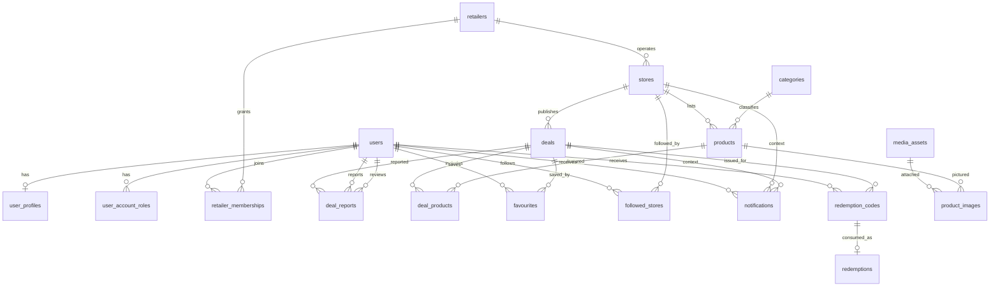

# DealSe PostgreSQL schema blueprint

**Status (reviewed 2026-11-14):** The Prisma schema and eight additive migrations are checked in. All eight were previously verified applied to the existing local PostgreSQL 18 + PostGIS `dealse_dev` database. No database was recreated and no production database was migrated. This document describes the current schema and selected future extensions; proposed tables below are explicitly marked deferred.

**Admin Backoffice:** Administrator accounts, permission grants, invitation records, a one-time bootstrap marker and admin audit context are implemented. The relevant additive migrations are listed below. API routes require the database Admin role, verified Supabase AAL2, an active account and the route permission. See [ADR 0005](adr/0005-admin-backoffice-foundation.md).

## Implemented P0 schema

The as-built Prisma schema and migrations are in `apps/api/prisma/`. They include users/profiles/account roles, retailer memberships, stores, categories, products, media metadata and image links, deals/moderation holds, customer deal reports, favourites, followed stores, notifications, admin accounts/permissions/invitations, audit logs, and online single-use redemption codes/redemptions. The initial migration enables PostGIS and creates a GiST index for store geography; the account-role migration adds `user_account_roles` and backfills existing users as customers without dropping data. See the migration inventory below for all eight checked-in migrations.

The custom SQL checks enforce normalized lowercase account email, verified/geocoded active stores, positive media dimensions/size, one primary image per entity, valid deal dates/discount representation, positive redemption caps, 32-byte SHA-256 code hashes, valid code expiry, and consistent deal/store/customer references for redemption rows. `Prisma` cannot represent the geography column as a generated location type; proximity queries must use a bounded, parameterized SQL repository.

Issue and confirm are server-owned. The authenticated session supplies `customer_user_id`; client-supplied customer IDs are not trusted. `deals.max_redemptions` is the global capacity and `deals.redemption_count` tracks confirmed redemptions. `deals.per_customer_limit` defaults to 1. The per-customer count filters by both `deal_id` and the authenticated `customer_user_id`; it does not include another customer's redemptions. A claim-time global-capacity check and separate per-customer check prevent claims beyond either limit; confirmation rechecks both while locking and atomically updating the deal and code. Outstanding claims do not increment `redemption_count`; only successful confirmations do. Validation is informational and consumes nothing. Staff membership is rechecked at confirmation. “Redeemed” means retailer-confirmed, not proof of purchase/payment. No offline confirmation is supported.

The local migration command is `pnpm --filter @dealse/api db:migrate:dev`. Do not run it against production; use the reviewed release path and `db:migrate:deploy` there.

## Conventions

- UUID primary keys generated by the application or `gen_random_uuid()`; opaque IDs avoid exposing row counts and make API IDs safer to merge/import, but authorization still depends on policy checks.
- `timestamptz` stored in UTC; UI formats with the store/user IANA time zone. Validity windows are half-open: `starts_at <= now() AND now() < ends_at`.
- Monetary values use integer minor units and ISO 4217 currency, never floating point.
- Use `text` plus `CHECK` constraints or Prisma enums for small controlled state sets; add migrations when states change.
- Retain provider identity as `(auth_provider, auth_subject)`; the identity provider owns passwords and refresh-token rotation.
- Foreign keys use `ON DELETE RESTRICT` for historical/financially meaningful records. Prefer deactivation/redaction over cascading deletion of published deals, redemptions or audit rows.
- Use `jsonb` only for constrained attributes, event properties and snapshots—not as a substitute for relations.
- Install PostGIS via a managed-database-supported extension migration. Keep location as `geography(Point, 4326)` and add GiST; test the actual provider/database. If the platform requires an extension schema, qualify the type/function accordingly. `citext` is also required for the case-insensitive `email_normalized` / `invited_email` columns, or replace those columns with normalized lowercase `text` if avoiding that extension.

## Relationship map

## Core identity, retailer and location

| Table | Columns, keys and important rules | Indexes / relationships |
|---|---|---|
| `users` | `id uuid PK`; `auth_provider text NOT NULL`; `auth_subject text NOT NULL`; `email_normalized citext NULL`; `email_verified_at timestamptz NULL`; `status text NOT NULL DEFAULT 'active'` (`active/suspended/deleted`); `created_at`, `updated_at`, `last_signed_in_at`. Unique `(auth_provider, auth_subject)`. Email may be null/private and must not be assumed unique across providers unless account-link policy confirms it. | Unique provider subject; partial unique email only if product policy requires it. No password/token columns when using managed identity. |
| `user_profiles` | `user_id uuid PK/FK users`; `display_name text`; `phone_e164 text NULL`; `locale text`; `avatar_asset_id uuid NULL FK media_assets`; `created_at`, `updated_at`. Minimize personal details. | Index phone only if lookup is required and policy permits it. |
| `user_account_roles` | `user_id uuid FK users`; `role account_role NOT NULL` (`customer/retailer/admin`); `created_at`; composite PK `(user_id,role)`. New authenticated identities receive `customer`; the server grants `retailer` only when it creates the retailer profile and owner membership. `admin` is granted by an authorized operator only. | PK supports role lookup by user; `(role,created_at)` for role-scoped administration/metrics. Never read roles from client input or Supabase user metadata. Admin API access additionally requires the verified Supabase JWT `aal2` claim. |
| `retailers` | `id uuid PK`; `display_name text NOT NULL`; `legal_name text NULL`; `status text NOT NULL` (`pending/active/suspended/closed`); `created_by_user_id uuid FK users`; `created_at`, `updated_at`, `deactivated_at NULL`. Legal/business verification fields deferred until policy is defined. | Index `(status, created_at)` for review queue. |
| `retailer_memberships` | `id uuid PK`; `retailer_id uuid FK retailers`; `user_id uuid FK users`; `role text NOT NULL` (`owner/manager/staff`); `status text NOT NULL` (`invited/active/revoked`); `invited_email citext NULL`; `invited_by_user_id uuid FK users`; `created_at`, `updated_at`, `revoked_at NULL`. Unique `(retailer_id,user_id)`. At most one active owner can be enforced transactionally or by a partial unique index if single-owner rule is chosen. | `(user_id,status)` and `(retailer_id,status)`; optional unique lower invited email while invite active. Tenant authorization begins here. |
| `stores` | `id uuid PK`; `retailer_id uuid FK retailers`; `slug text NOT NULL`; `name text NOT NULL`; `description text NULL`; `category_id uuid FK categories NULL`; `phone text NULL`; `email citext NULL`; address fields `address_line1`, `address_line2`, `locality`, `city`, `region`, `postal_code`, `country_code char(2)`; `location geography(Point,4326) NULL`; `timezone text NOT NULL` (IANA); `public_status text NOT NULL` (`draft/active/paused/closed`); `opening_hours jsonb NULL` validated against a versioned shape; `created_at`, `updated_at`, `published_at NULL`. Unique `(retailer_id,slug)`; one retailer may operate many stores. | GiST index on `location`; `(city,region,public_status)`; `(retailer_id,public_status)`; unique slug as above. Only active/public stores enter discovery. |
| `store_memberships` (optional restriction layer) | `store_id uuid FK stores`; `user_id uuid FK users`; `role_override text NULL`; `created_at`; composite PK `(store_id,user_id)`. Presence can restrict a retailer-wide user to assigned stores; define this semantics consistently. | PK plus `(user_id,store_id)`. If all retailer memberships see all stores, defer this table until store-scoped access is needed. |

`users` is a DealSe application profile linked to a Supabase Auth identity, not the identity provider's full user table. Keep passwords and refresh-token sessions in Supabase Auth; do not mirror provider secrets into Postgres.

## Catalog and media

| Table | Columns, keys and important rules | Indexes / relationships |
|---|---|---|
| `categories` | `id uuid PK`; `parent_id uuid FK categories NULL`; `slug text UNIQUE`; `name text`; `sort_order int`; `is_active boolean`; `created_at`, `updated_at`. | `(parent_id,sort_order)`; active slug unique. Keep seed-managed for early pilot. |
| `products` | `id uuid PK`; `retailer_id uuid FK retailers`; `store_id uuid FK stores NULL` (null means retailer catalog item, if approved); `category_id uuid FK categories`; `name text`; `slug text`; `description text NULL`; `brand text NULL`; `status text` (`draft/active/archived`); `created_by_user_id uuid FK users`; `created_at`, `updated_at`. Validate that `store_id` belongs to same retailer. Unique `(retailer_id,slug)` or `(store_id,slug)` according to catalog ownership model. | `(retailer_id,status,updated_at DESC)`; `(category_id,status)`; text search document GIN added in search migration. |
| `product_variants` (P1) | Only add when size/color/pack/SKU/barcode or per-variant stock matters. `id uuid PK`; `product_id uuid FK products`; `sku text NULL`; `barcode text NULL`; `label text`; `attributes jsonb`; `price_minor bigint NULL`; `currency char(3) NULL`; `is_active boolean`; `created_at`, `updated_at`. Unique SKU/barcode per retailer only after deciding reuse rules. | `(product_id,is_active)`; partial unique `(retailer_id,sku)` requires denormalized retailer_id or scoped validation. Defer rather than modeling unused variant machinery. |
| `media_assets` | `id uuid PK`; `owner_user_id uuid FK users`; `storage_provider text`; `bucket text`; `object_key text UNIQUE`; `purpose text` (`store/product/deal/avatar`); `mime_type text`; `byte_size bigint CHECK > 0`; `width int NULL`; `height int NULL`; `checksum_sha256 text NULL`; `processing_status text` (`pending/quarantined/ready/rejected/deleted`); `alt_text text NULL`; `created_at`, `updated_at`, `ready_at NULL`; `deleted_at NULL`. Never store image bytes here. | `(owner_user_id,created_at DESC)`; `(processing_status,created_at)`; unique object key. |
| `product_images` | `product_id uuid FK products`; `media_asset_id uuid FK media_assets`; `sort_order smallint`; `is_primary boolean`; composite PK `(product_id,media_asset_id)`. | Unique `(product_id,sort_order)`; at most one primary per product with partial unique index. |
| `store_images` / `deal_images` | Same join pattern with entity ID, asset ID, sort order, alt text. If each uses only one image, nullable `media_asset_id` directly on parent is simpler; use a relation only for gallery/multiple creatives. | Entity/order and unique primary constraints. Avoid generic polymorphic joins without FK if strict referential integrity matters. |

## Deals, engagement and inventory

| Table | Columns, keys and important rules | Indexes / relationships |
|---|---|---|
| `deals` | P0 fields are in Prisma schema and migration: store, creator, slug/title/summary/details/terms, explicit category, offer type and typed discount value, optional original/offer prices in minor currency units, optional image reference, start/end UTC instants with store time-zone snapshot, state (`draft/published/paused/ended`), optional total cap, redemption count, per-customer limit (default 1), version, and publish/create/update timestamps. Checks enforce date order, content, discount shape and cap limits. Moderation adds nullable `moderation_hold_at`, `moderation_hold_by_user_id` and `moderation_reason`; a held offer cannot be edited/published by the retailer and release returns it to draft. Unique `(store_id,slug)`. | Published-deal store/time partial index; state/window and `(store_id,created_at)` indexes. Category filtering uses the direct deal category. |
| `deal_reports` | `id uuid PK`; `deal_id uuid FK deals`; `reporter_user_id uuid FK users`; `reason deal_report_reason` (`misleading/expired/inappropriate/other`); optional `details varchar(1000)`; `status deal_report_status` (`open/resolved/dismissed`); optional resolution, reviewer user and review timestamp; created/updated timestamps. A customer may submit only one report per deal (`UNIQUE(deal_id,reporter_user_id)`). Admin review records outcome and reviewer. | `(status,created_at)` for the review queue; `(reporter_user_id,created_at)`; unique deal/reporter pair. |
| `deal_products` | `deal_id uuid FK deals`; `product_id uuid FK products`; optional `display_order`; composite PK `(deal_id,product_id)`. A service check ensures product and deal share retailer/store scope. | `(product_id,deal_id)`. |
| `favourites` | `user_id uuid FK users`; `deal_id uuid FK deals`; `created_at`; composite PK `(user_id,deal_id)`. | `(deal_id,created_at)` for aggregate counts; API only exposes own saved list. |
| `followed_stores` | `user_id uuid FK users`; `store_id uuid FK stores`; `created_at`; composite PK. A customer can follow only a public, verified, active store through the API. | `(store_id,created_at)` for aggregate count. |

| `notifications` | `id uuid PK`; `user_id uuid FK users`; `kind varchar(64)`; `title varchar(180)`; `body varchar(500)`; optional internal `href`; nullable `store_id`/`deal_id` context FKs; optional `dedupe_key`; `created_at`; nullable `read_at`. Notification creation is server-owned and only contains allowlisted text/links. Unique `(user_id,dedupe_key)` makes event retries safe. | `(user_id,created_at DESC)`, `(user_id,read_at,created_at DESC)`. Cascade when recipient is deleted; context references are set null if store/deal is removed. |

Current in-app event types are `RETAILER_PUBLISH_CONFIRMATION`, `STORE_ANNOUNCEMENT`, and `FAVOURITE_DEAL_UPDATED`. They are inserted in the same PostgreSQL transaction as deal publication/update. Dedupe keys include deal ID and version. The inbox is the persisted notification state; email/SMS/push delivery, devices, delivery attempts, and an outbox worker remain deferred until a delivery channel is selected.

### Marketplace migration rollout

`20261109120000_marketplace_deal_fields` is additive: it adds nullable category, price and image-reference columns to existing deals, an index and a check constraint, then inserts the current marketplace category taxonomy only for missing slugs. Apply with `pnpm --filter @dealse/api db:migrate:deploy`. If rollback is required before any marketplace writes, drop the new index, check, foreign key and four columns; remove only taxonomy rows that are not referenced by stores/products/deals. After those rows have been referenced or deal data has been written, prefer a forward fix or export/remap data before any rollback. No existing records are deleted by the migration.
| `inventory_levels` (P1) | `store_id uuid FK stores`; `variant_id uuid FK product_variants`; `quantity_available integer CHECK >= 0`; `low_stock_threshold integer NULL CHECK >= 0`; `updated_at`; `updated_by_user_id uuid FK users`; composite PK `(store_id,variant_id)`. | `(store_id,updated_at)`; optional partial low-stock index. Add an append-only `inventory_events` table if history/audit is needed. Not P0. |

**Deal publication constraints:** validate the store and product are active, the editor has membership, required terms/image fields are satisfied, start/end/time zone are valid, and status transition is permitted. Database checks handle local invariants; service transaction handles cross-table invariants. Do not trust `status`, `published_at`, discount, or store IDs supplied by a customer client.

## Implemented redemptions

| Table | Columns, keys and important rules | Indexes / relationships |
|---|---|---|
| `redemption_codes` | `id uuid PK`; `deal_id uuid FK deals`; `customer_user_id uuid FK users NOT NULL`; `token_hash bytea UNIQUE NOT NULL`; `issued_at timestamptz`; `expires_at timestamptz`; status `ISSUED/REDEEMED/EXPIRED/REVOKED`; request/audit metadata. A partial unique index permits at most one currently issued code per `(deal_id,customer_user_id)` while retaining all historical states. Store only the SHA-256 hash of the high-entropy code. | `(deal_id,status,expires_at)`; `(customer_user_id,issued_at DESC)`; unique token hash; partial unique issued-claim index. |
| `redemptions` | `id uuid PK`; `code_id uuid FK redemption_codes`; `deal_id uuid FK deals`; `store_id uuid FK stores`; `customer_user_id uuid FK users`; `redeemed_by_user_id uuid FK users`; `customer_redemption_number int`; `redeemed_at timestamptz`; idempotency/request metadata. Composite FKs guarantee code/deal/customer and deal/store consistency; unique `(deal_id,customer_user_id,customer_redemption_number)` enforces the customer sequence; store-scoped idempotency prevents duplicate confirmation. Historical redemptions are retained. | `(store_id,redeemed_at DESC)`; `(deal_id,redeemed_at DESC)`; `(customer_user_id,redeemed_at DESC)` under appropriate privacy access. |

Issue and confirm are server-owned. The authenticated session supplies `customer_user_id`; client-supplied customer IDs are not trusted. `deals.max_redemptions` is the global capacity and `deals.redemption_count` tracks confirmed redemptions. `deals.per_customer_limit` defaults to 1. The per-customer count filters by both `deal_id` and the authenticated `customer_user_id`; it does not include another customer's redemptions. Claim issuance and confirmation check this limit independently from the global cap. Confirmation uses a transaction with deal/code locking, eligibility and membership checks, conditional global-count increment, code status update, redemption insert and audit write. Outstanding claims do not increment `redemption_count`; only successful confirmations do. Validation is informational and consumes nothing. “Redeemed” means retailer-confirmed, not proof of purchase/payment. No offline confirmation is supported.

## External notification delivery (deferred)

The in-app `notifications` table is defined in the engagement section above and exists in the current Prisma schema. These additional delivery tables remain proposals; do not create them before selecting a delivery channel and defining consent, retry and retention policies.

| Table | Columns, keys and important rules | Indexes / relationships |
|---|---|---|
| `notification_devices` | `id uuid PK`; `user_id uuid FK users`; `platform text` (`ios/android/web`); `provider text`; `token_ciphertext text` or protected provider token; `token_fingerprint text UNIQUE`; `status text`; `last_seen_at`; `created_at`, `updated_at`, `revoked_at`. Encrypt token or use a protected delivery service; do not log it. | `(user_id,status)` and unique fingerprint. |
| `notification_deliveries` (P1) | `id uuid PK`; `notification_id uuid FK notifications`; `device_id uuid FK notification_devices NULL`; `provider_message_id text NULL`; `status text`; `attempt_count int`; `last_error_code text NULL`; `created_at`; `sent_at`, `delivered_at NULL`. Never store raw provider response with PII. | `(status,created_at)` retry queue; `(notification_id)`. |
| `outbox_events` | `id uuid PK`; `event_type text`; `aggregate_type text`; `aggregate_id uuid`; `payload jsonb` allowlisted; `occurred_at`; `available_at`; `processed_at NULL`; `attempts int DEFAULT 0`; `last_error_code text NULL`. Insert in the same transaction as domain changes. | Partial `(available_at,occurred_at) WHERE processed_at IS NULL`; `(aggregate_type,aggregate_id,occurred_at)`. Worker is at-least-once; consumers must dedupe by event ID. |

## Audit, product events and AI usage

| Table | Columns, keys and important rules | Indexes / relationships |
|---|---|---|
| `audit_logs` | `id uuid PK`; `actor_user_id uuid NULL FK users`; `actor_type text`; `action text`; `entity_type text`; `entity_id uuid NULL`; `retailer_id uuid NULL FK retailers`; `request_id uuid`; `before_snapshot jsonb NULL`; `after_snapshot jsonb NULL`; `created_at`. Redact credentials, tokens, phone/email unless needed. Append-only; snapshots limited to changed safe fields. | `(entity_type,entity_id,created_at DESC)`; `(actor_user_id,created_at DESC)`; `(retailer_id,created_at DESC)`. Restrict update/delete at DB role level. Define retention. |
| `product_events` | `id uuid PK` (event UUID from client or server); `name text`; `user_id uuid NULL FK users`; `anonymous_session_id uuid NULL`; `occurred_at timestamptz`; `received_at timestamptz DEFAULT now()`; `app_surface text`; `platform text NULL`; `app_version text NULL`; `store_id uuid NULL`; `deal_id uuid NULL`; `properties jsonb` allowlisted/size-bounded. Deduplicate by `id`. | `(name,occurred_at)`; `(user_id,occurred_at DESC)`; `(deal_id,name,occurred_at DESC)`. Partition by month only when size warrants it. Set retention/deletion before rollout. |
| `ai_requests` | `id uuid PK`; `actor_user_id uuid FK users`; `retailer_id uuid NULL FK retailers`; `store_id uuid NULL FK stores`; `feature text`; `provider text`; `model text`; `prompt_version text`; `input_hash text`; `input_tokens int NULL`; `output_tokens int NULL`; `estimated_cost numeric(12,6) NULL`; `currency char(3) DEFAULT 'USD'`; `latency_ms int`; `status text`; `error_code text NULL`; `created_at`; `request_id uuid`. Do not store full prompts/customer data by default. | `(retailer_id,created_at DESC)`; `(provider,model,created_at DESC)`; `(status,created_at)`. Restrict access; budget from aggregate usage. |

## Deferred tables and extensions

- `subscriptions`, `payment_customers`, invoices/payout tables: wait for confirmed monetization, legal, tax, refund and accounting requirements.
- `deal_embeddings` + `vector`: only after semantic search/recommendation has evaluation data and measured gains over full-text/trigram. Keep vector rows rebuildable from source records.
- `inventory_events`: add if retailers need auditable quantity movement or stock-based recommendations.
- Rich `search_documents`/external engine projection: add only when Postgres query quality/latency is insufficient.
- DealSe roles are sourced from `user_account_roles` in PostgreSQL; `admin` is never a Supabase user-metadata claim. NestJS checks the database role and requires a verified `aal2` claim for admin routes. Local development role bootstrap is restricted to loopback `dealse_dev`; production provisioning needs a separately reviewed operator process.

## Required query patterns and integrity checks

1. Nearby deals: eligible published deal + active store + current half-open validity; `ST_DWithin(store.location, requested_geography, radius_m)`; sort by distance then stable deal ID; cursor includes distance and ID. Require a bounded radius and return a bounded page.
2. Public deal page: resolve slug, then enforce active store, published status, current schedule and visibility policy. Do not treat an unlisted ID as private by obscurity.
3. Retailer list: every query includes authorized retailer/store scope; never load by ID and authorize later only in UI.
4. Save/favourite: composite unique key makes retries safe; use upsert or idempotent PUT/DELETE.
5. Redemption: composite code/deal/customer foreign key, unique customer redemption sequence, store-scoped idempotency key, transactionally update code and insert redemption; serialize cap checks with a deal-row lock.
6. Media: asset must be `ready`, owned/assigned to the same retailer/store, and allowed for target entity before attach.
7. Deal expiry: scheduled worker may set status to `ended`, but discovery always checks `ends_at > now()` so worker delay cannot keep an expired offer visible.
8. Product text search: weighted `tsvector` (name highest, retailer/store and description lower), GIN; trigram where typo tolerance matters. Do not create redundant indexes without checking writes/query plans.

## Migration inventory and rollout

Eight additive Prisma migrations are checked in, in order:

1. `20261005090000_initial_p0`
2. `20261108113000_user_account_roles`
3. `20261109120000_marketplace_deal_fields`
4. `20261110130000_admin_moderation_reports`
5. `20261111100000_in_app_notifications`
6. `20261112140000_admin_backoffice_foundation`
7. `20261112160000_moderation_rejected_states`
8. `20261113120000_one_issued_redemption_code_per_customer_deal`

The existing local `dealse_dev` database was previously verified with all eight applied. Production has not been migrated. Check local status with `pnpm --filter @dealse/api exec prisma migrate status`; use `pnpm --filter @dealse/api db:migrate:deploy` only after confirming the configured target is the intended development database. Review each additive migration before release; do not apply local migrations to production without a separately reviewed release plan.

The redemption migration preflights duplicate issued rows and creates a partial unique index for one issued code per customer/deal. It preserves redeemed, expired and revoked history. The D1 SQL in `prototype/migrations/0001_backend_foundation.sql` is historical prototype material and must not be run against or translated into the production schema without review.

### Applied admin/moderation migration

`20261110130000_admin_moderation_reports` adds the `admin` account-role enum value, moderation-hold fields on `deals`, and `deal_reports` with report lifecycle and reviewer foreign keys. It is additive and does not alter existing records. The local `dealse_dev` database has this migration applied; production has not. Since PostgreSQL enum values cannot be removed in place, rollback after role use should be forward-only or use a reviewed type rebuild.

`20261112140000_admin_backoffice_foundation` adds administrator accounts, permission grants, invitations, bootstrap state, and audit actor context. `20261112160000_moderation_rejected_states` adds the `rejected` status value to retailer, store, and deal enums so rejection remains distinct from pause, suspension, closure, and expiry. Both migrations are additive and applied only to local `dealse_dev`; production has not been changed. Rejection reasons and state snapshots use the existing audit log JSON fields.

`20261113120000_one_issued_redemption_code_per_customer_deal` adds the partial unique constraint that allows one currently issued claim per customer/deal while preserving historical claim and redemption rows. It is applied to local `dealse_dev`; production has not been changed.
